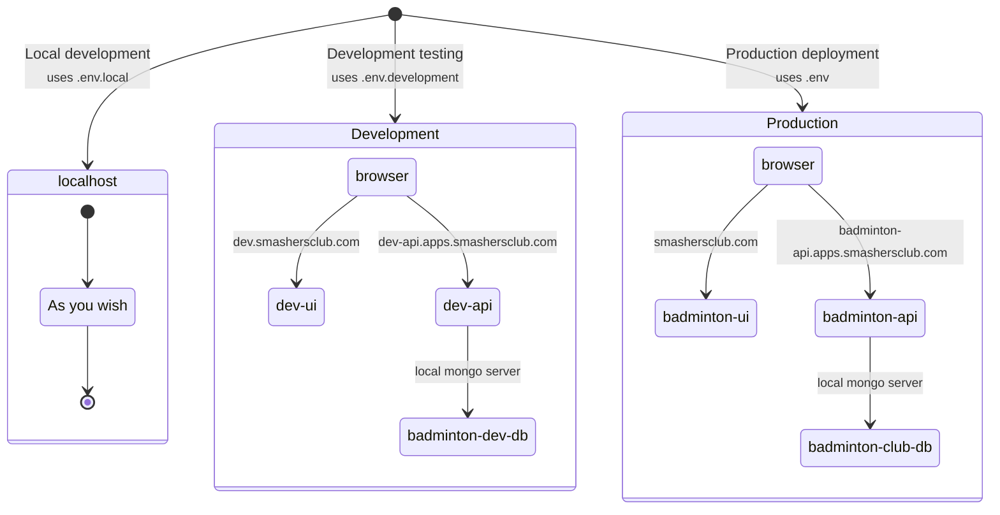

# Prerequisites
Before starting, ensure that you have the following installed on your system:

## Node.js and npm:
 Make sure Node.js and npm (Node Package Manager) are installed. You can download them from nodejs.org, which will also install npm.

## MongoDB: 
Install MongoDB from mongodb.com. Follow their installation instructions for your operating system.

## Setup Instructions
Clone the Repository: Open your terminal and clone the repository to your local machine.

```bash

git clone https://github.com/Almere-Badminton-Club/Badminton-Club-Server.git
```
Navigate to the Project Directory: Move into the cloned directory.

```bash

cd Badminton-Club-Server
```

## Install Dependencies: 
Install the required npm packages.

```bash
npm install
```
## Set Environment Variables: 
Create a `.env.local` file in the root directory of the project. You can use the existing `.env` file example as a template. Adjust the values as per your local setup.

## Start MongoDB: 
Ensure your MongoDB server is running. If not, start it according to your operating system's instructions.

```bash
mongod
```
## Run the Server: 
Start the Node.js server.

```bash
npm start  or npm run dev
```
This command will start the server and you should see output indicating that the server is running.

## Testing: 
Once the server is running, you can test the endpoints using a tool like Postman or by integrating them with your frontend application.


# Deployment 

We use [dokku](https://dokku.com/) as a baremetal deployment tool. 

We have two deployment pipeline setup. One is development and one is prod. Each setup contains three services ( the ui, the api and the mongo db). Application layout looks like this -



## Deploying on [development](https://dev-api.apps.smashersclub.com)

1. Make sure your ssh public key is added to the production machine. If not ask admin
2. Add dokku as your git remote

```
git remote add dev-smashersclub dokku@51.20.185.99:dev-api
```
3. To deploy, just to git push to dokku

```
git push dev-smashersclub
```


## Deploying To [production](https://badminton-api.apps.smashersclub.com)

1. Make sure your ssh public key is added to the production machine. If not ask admin
2. Add dokku as your git remote

```
git remote add prod-smashersclub dokku@51.20.185.99:badminton-api
```
3. To deploy, just to git push to dokku

```
git push prod-smashersclub
```

